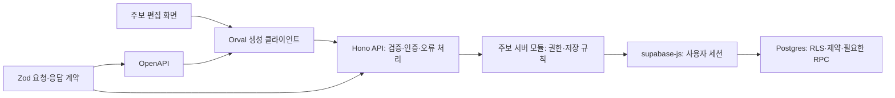

# Supabase 백엔드 스택 조사 및 추천

> 후속 방향: [현재 DB 초안](weekly-data-model.md)은 weekly를 발행 조합으로 두고 sermon/family/sender 콘텐츠와 files를 분리한 v0.6 안이다. 아래 과거 팀 분리·Hono/OpenAPI 예시는 현재 구현안이 아니다.

조사일: 2026-11-12. 현재 저장소와 로컬 safy의 코드·ADR, 각 도구의 공식 문서를 확인했다. 아래는 구현 전 제안이며 확정된 ADR이나 운영 DB의 실측 결과가 아니다. 이번 작업에서 패키지 설치, 앱 코드 변경, 마이그레이션 생성·실행은 하지 않았다.

## 1. 추천

**현재 Next.js 안에서 Hono HTTP API를 운영하고, Zod로 계약을 정의해 OpenAPI와 Orval 클라이언트를 생성한다. 데이터 접근은 supabase-js, DB 변경은 Supabase SQL migrations 하나로 관리한다.**

Supabase는 Postgres·인증·파일 저장을 맡는다. 주보 저장, 팀 권한 확인, 오류 변환 같은 앱의 업무 로직은 기능별 서버 모듈이 맡는다. 별도 백엔드 서버를 먼저 만들 필요는 없다. Next.js는 Route Handler로 HTTP API를 제공할 수 있고, Hono는 Next.js Node 런타임에 탑재할 수 있다. 이 구성은 현재 웹 기능을 위한 추천이며 장시간 작업까지 Next.js에서 처리하자는 뜻은 아니다. [Next.js BFF](https://nextjs.org/docs/app/guides/backend-for-frontend), [Hono Next.js 연동](https://hono.dev/docs/getting-started/nextjs)

| 영역 | 선택 | 이유 |
| --- | --- | --- |
| 실행·배포 | 기존 Next.js App Router + Node 런타임 + Vercel | 웹/API 배포를 현재 저장소에서 유지 |
| HTTP API | Hono + `@hono/zod-openapi` | 요청 검증·응답 계약·명세를 같은 라우트 정의에 연결 |
| 입력·출력 계약 | 기존 Zod 4 | RHF 폼과 서버가 재사용 가능한 구조 검증 |
| 클라이언트 생성 | Orval, 우선 fetch 출력 | API 함수·요청/응답 타입 수작업 제거 |
| 데이터 접근 | 기존 `@supabase/supabase-js` | 사용자 세션으로 Data API 접근, 생성 DB 타입 적용 |
| 인증 세션 | 기존 `@supabase/ssr` + Supabase Auth | 자체 JWT/갱신 서버를 중복 구현하지 않음 |
| DB 변경 | `supabase/migrations/*.sql` | 테이블·제약·RLS·grant·RPC 변경의 단일 이력 |
| 파일 | Supabase private Storage | 원본 파일과 DB의 편집 메타데이터 분리 |
| 검증 | API 통합 테스트 + 로컬 Supabase + pgTAP | 팀 격리, 저장 충돌, 원자성, 타입 생성 확인 |

Hono의 Zod OpenAPI 연동은 검증과 명세 생성을 지원한다. 응답 스키마 선언만으로 모든 응답의 런타임 검증이 자동 적용된다고 가정하지 않는다. 계약 테스트에서 실제 응답을 스키마로 검사한다. Orval은 OpenAPI에서 fetch 함수와 응답 타입을 생성할 수 있다. [Hono Zod OpenAPI](https://hono.dev/examples/zod-openapi), [Orval fetch](https://orval.dev/docs/guides/fetch/)

추가 의존성의 목적은 분명하다. Hono는 API 공통 처리, Zod OpenAPI는 계약 연결, Orval은 개발 시 코드 생성이다. Next.js 어댑터 등 부속 패키지와 Zod 4 호환 버전은 설치 전에 맞춘다. 이번 조사에서는 설치·번들 크기·해당 조합의 빌드를 검증하지 않았다.

## 2. safy에서 가져올 것

확인한 기준 문서:

- `../safy/docs/adr/0001-api-spec-is-the-action-catalog.md`: API 명세를 액션 목록으로 사용하고 정의를 중복하지 않는 방향.
- `../safy/docs/adr/0004-docs-api-rules.md`: 도메인별 자원 주소, 오류 코드·필드 오류, 서버 검증, 한 번의 저장 트랜잭션, 동시 수정 충돌, 명세 기반 타입 생성 규칙.
- 실제 코드: `../safy/safy-server/.../docs/project/controller/DocsProjectController.java`, `../safy/safy-web/apps/docs/src/lib/api/client.ts`, `../safy/safy-web/apps/docs/src/lib/api/docs/`, `../safy/safy-web/apps/client/orval.config.ts`.

현재 로컬 safy는 Spring Boot 서버, 도메인별 서비스·조회 모듈, 공통 전송/오류 처리, 일부 앱의 Orval 생성을 사용한다. docs 앱에는 수동 API 선언도 남아 있다. ADR의 목표와 모든 코드의 현 상태가 완전히 같다고 보지는 않는다.

hummunication에 적용할 규칙은 다음 정도면 충분하다.

1. 브라우저의 업무 저장은 우리 API를 통해 요청한다. 화면마다 Supabase 쓰기를 흩어 놓지 않는다.
2. 라우트는 검증·인증·응답을 연결하고, 실제 업무는 기능별 서비스가 수행한다.
3. 공통 오류는 safy의 `errorCode`, `message`, `fieldErrors`로 통일한다. 필드 오류는 RHF `setError`, 나머지는 공통 안내로 표시한다. 원본 DB 오류를 그대로 노출하지 않는다. 요청 추적 ID는 응답 헤더와 서버 로그에서 관리한다.
4. 목록은 `{ items, total }`, 페이지·정렬 규칙을 통일한다. 현재 필요하지 않은 검색 필터까지 선제 구현하지 않는다.
5. 같은 저장 규칙을 API·Server Action·화면에 각각 구현하지 않는다. 공개 업무 API는 HTTP 계약 하나로 유지한다.
6. API 계약, DB 타입, 화면 폼 타입을 수동 복제하지 않는다.

Spring의 JPA·QueryDSL·별도 서버 운영까지 복사할 이유는 현재 요구에서 확인되지 않았다.

## 3. 실행 흐름과 파일 위치



사용자가 선호하는 feature-based 구조에 맞춰 계약·API·서비스를 도메인 안에 모은다. 아래는 예상 위치이며, 지금 이 폴더들을 생성하자는 뜻은 아니다. 구체적인 규칙과 코드는 [백엔드 구현 예시](backend-implementation-example.md)에 정리했다.

```text
src/app/api/[[...route]]/route.ts    # Next.js 진입점
src/server/api.ts                   # 라우터 조립, 공통 오류 처리
src/features/bulletins/routes.ts    # HTTP 계약 연결
src/features/bulletins/service.ts   # server-only 업무 처리와 쿼리
src/features/bulletins/schemas.ts   # 공유 요청·응답 Zod 스키마
src/generated/api/                 # OpenAPI에서 생성, 직접 수정 금지
src/lib/supabase/database.types.ts # 로컬 DB에서 생성, 직접 수정 금지
supabase/migrations/               # DB 변경의 정본
supabase/tests/                    # RLS·제약·RPC 검증
```

초기에는 서비스 파일 안에서 쿼리까지 처리한다. 저장소 인터페이스·repository 클래스·범용 CRUD 팩토리는 반복이나 복잡도가 실제로 생길 때 분리한다. 서버 내부 조회는 같은 서비스 함수를 직접 호출해 불필요한 자기 HTTP 호출을 피한다. 모든 외부 쓰기 진입점은 같은 권한 검증을 거쳐야 한다. Next.js도 서버 전용 데이터 접근 모듈과 최소 데이터 반환을 권장한다. [Next.js 데이터 보안](https://nextjs.org/docs/app/guides/data-security)

## 4. 타입의 주인

| 종류 | 정본 | 생성·사용 방향 |
| --- | --- | --- |
| DB Row/Insert/Update/RPC | SQL migration으로 재현한 DB | Supabase CLI → `Database` 타입 → 서버 클라이언트 |
| API 요청·응답 | 기능별 Zod 계약 | OpenAPI → Orval 타입·호출 함수 |
| 폼 값·초기값 | 기존 같은 폴더의 `schemas.ts` | 공유 계약의 필요한 스키마 재사용 + RHF 기본값 |
| Tiptap 문서 | 공유 rich-document Zod 스키마 | 에디터·서버·출력 변환에서 재사용 |

DB 타입은 저장 구조다. API DTO는 화면에 제공할 구조다. 예를 들어 DB의 `content`, 내부 파일 경로, 팀 권한 필드를 통째로 브라우저에 반환하지 않는다. 날짜·시간은 API에서 ISO 문자열로 통일하고, DB 컬럼명과 화면 필드명 변환은 서버 한곳에서 처리한다.

Supabase 생성 타입은 테이블 및 함수의 구조를 반영한다. JSONB 안의 Tiptap 문서가 유효한지까지 증명하지는 않는다. JSONB 경계에서는 Zod 런타임 검증을 유지한다. [Supabase 타입 생성](https://supabase.com/docs/guides/api/rest/generating-types), [Supabase JSON](https://supabase.com/docs/guides/database/json)

CI에서는 로컬 migration 재생 → DB 타입 생성 결과 비교, API 명세·클라이언트 재생성 결과 비교 → typecheck를 한다. Zod의 사용자 정의 refine 같은 업무 규칙이 OpenAPI로 모두 전달된다고 가정하지 않는다. 서버 검증이 최종 기준이고 핵심 제약은 DB에서도 보장한다.

## 5. DB는 화면 전체를 과도하게 테이블로 나누지 않기

현재 사용 방식은 주보 한 건을 함께 저장하는 문서 편집이다. 이 기준의 초기 제안은 다음 네 테이블이다. 기존 미반영 DB 초안을 자동 확정하거나 운영 테이블이 이미 존재한다고 가정한 것이 아니다.

| 테이블 | 책임 |
| --- | --- |
| `teams` | 팀 식별 |
| `team_memberships` | 팀과 Auth 사용자 연결, 공동 조회·편집 권한 |
| `bulletins` | UUID, 팀, 발행일, 콘텐츠 JSONB, 버전, 수정자·수정 시각 |
| `media_assets` | 팀, Storage 경로, 파일 형식·크기·원본 크기 등 메타데이터 |

주보는 `(team_id, publication_date)` 유일 제약을 두고, 발행일 자체를 전역 기본키로 쓰지 않는다. 콘텐츠 JSONB에는 설교 기본 정보·Tiptap 문서·순별 문답·사진 ID·크롭 정보를 보관한다. 사진 원본은 Storage에 둔다. 독립 검색·권한·수정 주기가 생긴 항목만 나중에 별도 테이블로 분리한다. JSONB 사용은 Postgres 지원 기능이며, 이 테이블 구성은 현재 편집 흐름에 대한 설계 판단이다. [Supabase JSON](https://supabase.com/docs/guides/database/json)

Tiptap JSON을 편집 원본으로 유지한다. HTML과 페이지 분할은 기존의 검증·이스케이프된 렌더러에서 파생한다. 원본 HTML·JSON·페이지 배열을 각각 편집 가능한 값으로 저장하지 않는다. 콘텐츠 형식 변경을 위한 `schemaVersion`과 동시 저장 방지를 위한 `version`은 역할이 다르다.

동시 저장은 `expectedVersion`으로 확인한다. 같은 버전을 읽은 두 사람이 저장하면 먼저 저장한 요청만 성공하고, 뒤 요청은 409로 알려 입력 내용을 보존한다. 사용자의 safy 규칙 선호에 따라 수정은 PATCH로 통일한다. 생략한 속성은 유지하고, nullable 속성에 보낸 null은 비우며, 중첩 객체는 속성별로 반영하고 배열은 통째로 교체한다. 현재 화면의 미완성 상태도 저장해야 하므로 저장 스키마와 완료 검증 스키마를 구별한다. UI 문구는 기존 요청대로 ‘저장’을 유지한다.

여러 테이블을 함께 바꾸는 저장만 PostgreSQL 함수/RPC로 묶는다. 연속된 여러 supabase-js 호출은 전체가 하나의 트랜잭션이 아니다. PostgREST는 한 요청을 트랜잭션으로 실행한다. 기본은 `security invoker`이며, `security definer`가 필요한 함수는 권한 검사·고정 search_path·실행 grant를 별도로 검토한다. [PostgREST 트랜잭션](https://docs.postgrest.org/en/stable/references/transactions.html), [Supabase DB 함수](https://supabase.com/docs/guides/database/functions)

## 6. 로그인 없이 진입하기와 팀 데이터 권한

홈·편집기 UI 진입을 공개로 유지하는 것과 팀의 서버 데이터 쓰기를 공개하는 것은 별개의 결정이다. 기존 ‘로그인 없이 진입’ 요구는 유지할 수 있다. 추천은 공개 진입·로컬 체험을 허용하고, 팀 데이터 조회·저장에 필요한 시점에 기존 admin 발급 계정의 Supabase 세션을 사용하는 방식이다. 이는 제안이며 로그인 요구를 이번 작업에서 추가하지 않았다.

발행일 6자리 확인과 sessionStorage는 현재 요청대로 만든 UI 잠금이다. 팀원임을 증명하지 않으므로 서버 DB 쓰기 권한으로 사용하면 같은 날짜를 아는 누구나 수정할 수 있다. **로그인 없는 서버 저장까지 원한다면 팀원을 어떻게 식별할지 별도 제품 결정을 먼저 해야 한다.** 공개 읽기 범위도 확정이 필요하다. 새가족 이름·문답·사진을 포함한 전체 주보가 자동으로 공개되어서는 안 된다.

서버는 기존 규칙대로 `getClaims()`로 검증한 사용자 ID를 얻고 DB의 팀원 관계를 확인한다. JWT 안의 팀 정보만 믿으면 권한 변경이 즉시 반영되지 않을 수 있다. `getClaims()`는 검증된 JWT claims이며 최신 사용자 레코드 조회와는 다르다. 공개 화면에도 세션 기반 조회를 연결할 때는 현재 공개 경로의 Proxy 우회와 세션 갱신 방식을 다시 맞춰야 한다. API의 인증 실패는 로그인 HTML 리다이렉트 대신 JSON 401로 통일한다. [Supabase SSR 인증](https://supabase.com/docs/guides/auth/server-side/creating-a-client?queryGroups=framework&framework=nextjs)

일반 업무 호출은 사용자 세션 클라이언트를 사용하고 RLS를 적용한다. admin용 secret 클라이언트를 모든 저장의 기본으로 쓰지 않는다. 테이블마다 RLS와 최소 grant를 같은 migration에 작성하며, 팀 ID는 요청으로 받았다는 이유만으로 신뢰하지 않는다. [Supabase RLS](https://supabase.com/docs/guides/database/postgres/row-level-security)

우리 API를 거치도록 UI를 구성했다고 Supabase Data API의 직접 호출이 막히는 것은 아니다. 공개 키를 아는 클라이언트도 부여된 DB 권한으로 요청할 수 있다. 팀 격리·허용 컬럼·중복·형식·버전 같은 불변 조건을 RLS/제약/필요한 RPC로 보장하고 직접 호출도 테스트한다. API 전용으로 반드시 제한할 쓰기는 해당 테이블의 직접 쓰기 권한과 RPC 노출 경계를 따로 설계한다. [Supabase API 접근 제어](https://supabase.com/docs/guides/api/securing-your-api)

쿠키 인증의 HTTP 쓰기는 Origin/CSRF 검사, JSON Content-Type, 크기 제한을 공통 처리한다. Hono는 CSRF 미들웨어를 제공하지만 모든 JSON 요청까지 자동 검사된다고 전제하지 않고 적용 범위를 확인한다. 개인·팀 응답과 signed URL은 공유 캐시에 넣지 않는다. [Hono CSRF](https://hono.dev/docs/middleware/builtin/csrf)

## 7. 사진 업로드

현재 `uploads` 버킷 정책은 `{auth.uid()}/...`의 개인 폴더 접근이다. 팀원 공동 접근을 위해서는 새 migration으로 팀 기반 Storage 정책을 추가해야 한다. 기존 정책 파일을 고치거나 버킷을 public으로 바꾸는 방식으로 해결하지 않는다.

파일은 권한 확인 후 Storage에 직접 전송하고, 우리 저장 API에는 asset ID와 크롭 정보만 보낸다. 업로드용 제한된 URL을 사용하면 브라우저의 전송 부하를 Next.js가 중계하지 않아도 된다. 서버는 연결하려는 asset의 팀·업로드 완료 여부를 확인한다. 보기 URL은 권한 확인 후 제한된 유효기간으로 제공하고 영구 DB 값으로 저장하지 않는다. [Supabase Storage 접근 제어](https://supabase.com/docs/guides/storage/security/access-control), [private 파일 제공](https://supabase.com/docs/guides/storage/serving/downloads)

Storage 업로드와 DB 저장은 하나의 DB 트랜잭션으로 묶이지 않는다. 업로드 실패·본문 저장 실패를 구분하고, 본문 저장 성공 전에는 기존 사진을 지우지 않는다. 미연결 업로드의 만료·정리 규칙은 업로드 구현 단계에서 작게 추가한다.

## 8. 대안과 선택 이유

| 후보 | 적합한 경우 | 이번 판단 |
| --- | --- | --- |
| Next.js Server Actions + supabase-js + Zod | 웹 내부 기능만 있고 API 명세가 필요 없을 때 | 의존성이 가장 적은 대안. safy처럼 API 목록·계약을 중심으로 정리하려는 이번 방향에서는 차선 |
| Next Route Handler + Zod, Hono 없음 | API가 몇 개이며 공통 래퍼만으로 충분할 때 | 가능. 라우트와 명세가 분리되어 어긋나지 않도록 별도 연결 필요 |
| Hono + Zod OpenAPI + Orval | HTTP API를 명세·타입·검증과 함께 관리할 때 | 이번 추천. 별도 서버 없이 safy의 계약 중심 운영 방식 적용 |
| tRPC | TypeScript 소비자끼리 빠르게 타입을 공유할 때 | 좋은 대안이나 이번 OpenAPI 중심 흐름과 별도 체계로 겹쳐 도입하지 않음 |
| Drizzle | 직접 SQL 조립·서버 트랜잭션 수요가 클 때 | RLS를 지원하지만 직접 연결의 역할/JWT 컨텍스트는 별도로 설계해야 함. 현재는 보류 |
| Prisma | 독립 서버의 ORM 모델 중심으로 운영할 때 | Supabase와 사용 가능. 현재 SQL migration·RLS 기준에 ORM 모델/운영 경계를 추가할 이익이 작음 |
| NestJS 또는 Spring 별도 서버 | 독립 배포·서버 팀·장기 작업 등 별도 운영 필요가 있을 때 | 현재 확인된 요구보다 운영 범위가 커짐. 필요가 생기면 서비스 모듈을 옮길 수 있게 유지 |

위 적합성 판단은 문서 기능과 현재 프로젝트 요구를 비교한 의견이며 성능 벤치마크 순위가 아니다. [tRPC](https://trpc.io/docs), [Drizzle RLS](https://orm.drizzle.team/docs/rls), [Supabase Prisma](https://supabase.com/docs/guides/database/prisma), [NestJS OpenAPI](https://docs.nestjs.com/openapi/introduction)

TanStack Query는 서버 상태 공유·캐시 무효화가 실제로 필요해질 때 도입한다. 초기에는 Orval fetch로 충분한지 먼저 확인한다. Axios·tRPC·Hono RPC 클라이언트까지 같은 역할로 동시에 설치하지 않는다. 별도 Edge Functions에도 같은 주보 저장 로직을 복제하지 않는다.

## 9. 구현 순서와 완료 조건

1. **읽기 공개 범위·팀 저장 인증 방식 결정** → 공개 진입은 유지하면서 누가 어떤 서버 데이터를 읽고 쓰는지 설명 가능.
2. **주보 저장 한 흐름의 계약 정의** → 생성·조회·저장, 목록·필드 오류·409를 Zod/OpenAPI로 표현. JSONB 본문과 사진 참조의 DB 검증 범위 확정.
3. **로컬 migration + 생성 DB 타입** → 팀 RLS, 최소 grant, 유일 제약, 버전 갱신을 운영 DB와 분리해 검증.
4. **Hono API + 서비스 + Orval 생성 연결** → 정상 저장/새로고침, 미완성 저장, 잘못된 입력, 비로그인, 다른 팀, 동시 저장을 실제 요청으로 검증.
5. **Storage 연결 + 로컬 자료 가져오기** → 팀원의 사진 조회, 원본·크롭 유지, 업로드 실패 시 이전 저장본 보존. 로컬 원본은 서버 저장 성공 전 지우지 않음.
6. **CI 후 운영 반영** → 기존 lint/typecheck/build와 함께 타입·명세 생성 차이, API 계약, DB 권한 테스트 통과. migration의 main 머지는 운영 적용이라는 현재 규칙 준수.

RLS 테스트는 API의 403만 확인하지 않고 다른 팀의 JWT로 Data API/Storage에 직접 접근하는 경우도 포함한다. 동시 저장 충돌은 마지막 저장이 조용히 덮어쓰지 않아야 한다. Hono는 서버를 띄우지 않는 요청 테스트를 지원하며, Supabase는 로컬 DB·pgTAP 검증 흐름을 제공한다. [Hono 테스트](https://hono.dev/docs/guides/testing), [Supabase 테스트](https://supabase.com/docs/guides/local-development/testing/overview)

조사 범위는 로컬 코드와 공개 공식 문서다. 운영 Supabase의 실제 정책·설정·데이터, 패키지 조합의 실행, 부하·비용은 확인하지 않았다. 이번 문서만으로 DB 설계나 운영 반영이 확정되지는 않는다.
